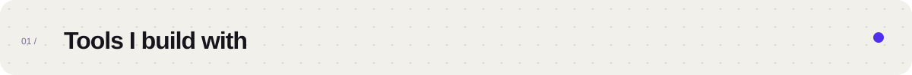
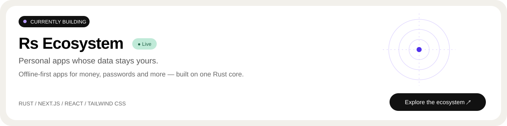

  
  
  

I design and build software across **backend, web and mobile**, translating business requirements into scalable technical solutions. My work spans ERP, supplier portals, HRIS and e-commerce platforms.

Alongside building features, I review code, mentor junior engineers, troubleshoot production issues and contribute to architecture decisions.

   
   
  

  <a href="https://www.ihsan.my.id/#work">More selected work ↗</a> &nbsp; · &nbsp;
  <a href="https://github.com/ihsanwahyudin?tab=repositories">Explore my repositories ↗</a>

